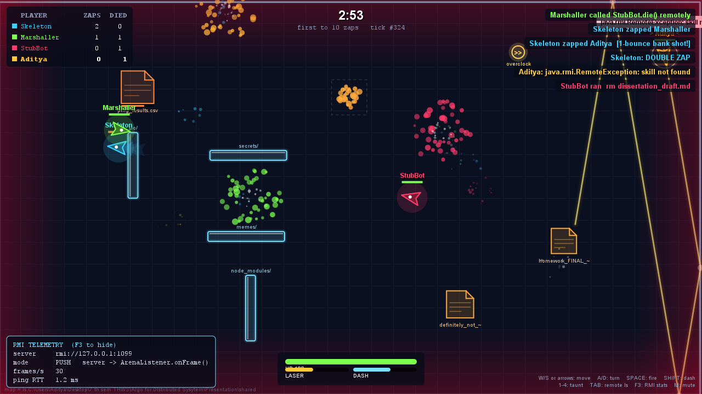
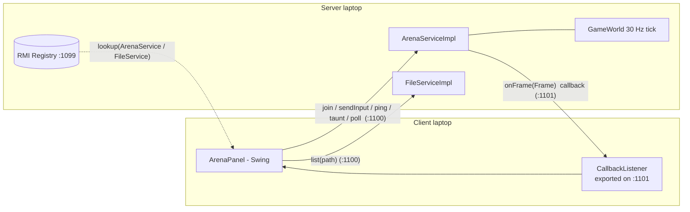
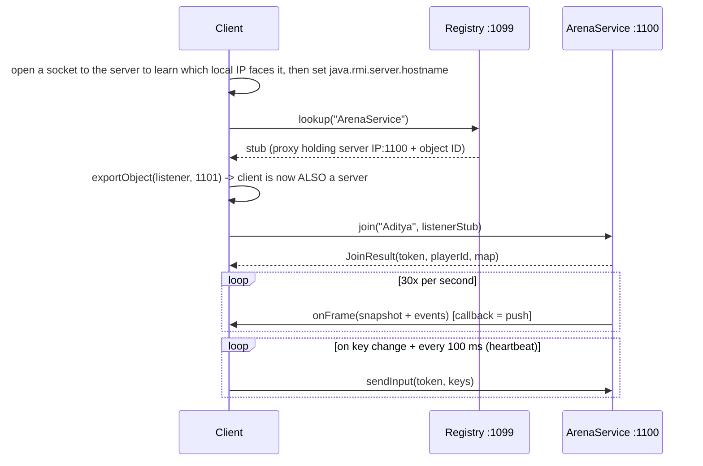

# RMI Arena — Java RMI Seminar

**Seminar 1 — Communication with RPCs · Framework: Java RMI**

This repo has two parts:

1. **[`howto/`](howto/)** — the required HowTo: list a folder on a remote machine (`ls` / `dir`) with Java RMI, in three short files. Small enough to put on slides.
2. **RMI Arena** — a multiplayer laser battle between laptops, built on the same ideas. It covers the second requirement, *event-based communication using RPCs*: the server pushes every game frame to the clients through **RMI callbacks**.

The arena is built from a **directory listing of the server's file system**: every folder becomes a mirror that reflects lasers, and every file becomes a crate you can shoot (`StubBot ran rm homework_FINAL_v3.txt`). Press <kbd>TAB</kbd> in game to browse that same folder with remote `ls` calls.



---

## 1. Quick start (demo day)

**Every laptop needs Java 17 or newer** (`java -version`). The machine that builds the jar needs a JDK.

```bash
build.bat            # Windows   (or: sh build.sh on macOS/Linux)
```

This produces `rmi-arena.jar`. Copy that one file to your friends' laptops (USB, chat, AirDrop). They don't need the source code.

| Who | Command |
|---|---|
| **Server** (your laptop) | `java -jar rmi-arena.jar server` |
| **Client** (each friend) | `java -jar rmi-arena.jar client <server-ip> <name>` |
| Extra AI players (any laptop) | `java -jar rmi-arena.jar bot <server-ip> 3` |
| The HowTo as a command | `java -jar rmi-arena.jar ls <server-ip> [path]` |

You can also **double-click the jar**: a small launcher asks whether to host or join.

The server prints its IP address in a banner and opens the **Control Room** window (the projector view). It shows a live spectator view, connected clients, remote calls per second, and a log of every `join` / `list` / `leave` call. The **+ Bot** button adds AI players, which helps when only 2 laptops are available.

To play on the server laptop too, start a second terminal there: `java -jar rmi-arena.jar client localhost <name>`.

### Server options

```
server [--host IP] [--dir FOLDER] [--kills N] [--minutes M] [--headless]
```

* `--host` — the IP written into the stubs. It is auto-detected, but pick it yourself if the banner shows the wrong adapter (e.g. VMware/VirtualBox) or you use Tailscale.
* `--dir` — the folder that becomes the map and the `ls` share. Default: `shared/` (a demo folder with suitably silly files).
* `--kills` / `--minutes` — round length. Default: first to 10 kills or 3 minutes.

### Controls

| Key | Action |
|---|---|
| <kbd>W</kbd>/<kbd>S</kbd> or ↑/↓ | thrust forward / back |
| <kbd>A</kbd>/<kbd>D</kbd> or ←/→ | turn |
| <kbd>Space</kbd> | fire laser (each bounce off a wall/mirror adds **+65 % damage**: bank shots) |
| <kbd>Shift</kbd> | dash |
| <kbd>1</kbd>–<kbd>4</kbd> | taunts (`java.rmi.RemoteException: skill not found`) |
| <kbd>TAB</kbd> | **remote `ls`** of the server's folder (↑/↓, Enter, Backspace) |
| <kbd>F3</kbd> | RMI telemetry overlay · <kbd>M</kbd> mute |

Green **hotfix** pickups heal; yellow **overclock** pickups give rapid fire.

---

## 2. Network checklist — read this before the seminar

Distributed systems fail in distributed ways. Most RMI demos break because of networking, not code.

1. **Same network.** Campus Wi-Fi (eduroam) often isolates devices from each other. The most reliable setup is **one phone hotspot that every laptop joins**. Tailscale also works (start the server with `--host <tailscale-ip>`).
2. **Firewall.** The first time Java listens on a port, Windows asks for permission. **Allow it on Private *and* Public networks**, on every laptop. Or open the ports once from an admin terminal:
   ```
   netsh advfirewall firewall add rule name="RMI Arena" dir=in action=allow protocol=TCP localport=1099-1101
   ```
   (Remove it afterwards: `netsh advfirewall firewall delete rule name="RMI Arena"`.)
3. **Ports used:** `1099` registry · `1100` server objects · `1101` client callbacks. All are fixed, so firewall rules stay simple.
4. **Test the day before** with `ls` from a friend's laptop: `java -jar rmi-arena.jar ls <server-ip>`.

If a client's firewall blocks the callbacks anyway, the game keeps working. The client notices that no frames are arriving and switches from **PUSH** to **PULL** (polling) by itself. The HUD then shows `mode PULL`. That fallback is worth showing in the talk (see §5).

---

## 3. How RMI is used



### Remote interfaces (the "IDL" of RMI is plain Java)

| Interface | Lives on | Methods | Purpose |
|---|---|---|---|
| [`FileService`](src/arena/common/FileService.java) | server | `list(path)`, `rootName()` | the HowTo: remote `ls`, restricted to the shared folder |
| [`ArenaService`](src/arena/common/ArenaService.java) | server | `join`, `sendInput`, `poll`, `ping`, `taunt`, `leave` | client → server requests |
| [`ArenaListener`](src/arena/common/ArenaListener.java) | **client** | `onFrame(Frame)` | server → client **callback** (event push) |

Everything else in [`arena.common`](src/arena/common/) is a `Serializable` record that is **passed by value**: `PlayerInput`, `Frame`, `GameSnapshot`, `GameEvent`, `MapData`, `FileEntry`. Remote objects are **passed by reference**: the client sends its `ArenaListener` *stub* as an ordinary argument to `join()`, and the server later calls methods on it. That is the central RMI idea behind this project.

### One join, step by step



### Design decisions worth talking about

* **Server-authoritative.** Clients only send key states. Movement, laser ray-tracing with reflections, damage and scores are computed in [`GameWorld`](src/arena/server/GameWorld.java), so nobody can cheat by sending fake positions. The `join()` token comes from `SecureRandom`, so one client cannot steer another client's ship.
* **One push thread per client** ([`Session`](src/arena/server/Session.java)). An RMI call blocks until it returns, so a slow laptop must never stall the game loop. Snapshots are **conflated** (if a client lags, it skips stale frames and gets the newest one). Events such as kills or joins are **queued, and re-queued if a callback fails**, so a hiccup doesn't drop them.
* **Push with pull fallback.** After 3 failed callbacks the server stops pushing. If the client receives no frames for 2.5 s, it starts calling `poll()`. This is the *push vs. pull* trade-off from the lecture, running live.
* **Failure detection.** `sendInput` doubles as a heartbeat. Clients that are silent for 8 s are removed (`timed out`). The RMI response timeout is lowered to 4 s, so a vanished peer causes an exception instead of a 20 s hang ([`Net`](src/arena/common/Net.java)).
* **`java.rmi.server.hostname`** is the classic RMI pitfall: the stub contains the IP the client will connect to. The server takes it from `--host` or auto-detection. The client sets its own value by opening a socket to the server and reading which local address the OS chose ([`Net.localAddressTowards`](src/arena/common/Net.java)).
* **Security.** `FileService` normalises paths and refuses anything outside the shared folder: `ls ../..` returns `Access denied`. RMI deserialises incoming objects, so never expose RMI to untrusted networks. Production setups add `jdk.serialFilter` and TLS socket factories.
* **Cost of a frame.** About 1.1 KB serialised (shown live in the Control Room). At 30 Hz with 3 clients, that is roughly 100 KB/s. Java serialisation is convenient, not compact. That gives a natural comparison with gRPC/Protobuf or Cap'n Proto from the other groups.

---

## 4. Where RMI fits in the lecture's view

| Lecture concept | In Java RMI / this project |
|---|---|
| Interface definition (IDL) | Plain Java interfaces extending `Remote`. No separate IDL and no code generator, but Java only |
| Client stub / server skeleton | Dynamic proxy generated at runtime (`Proxy` + `RemoteObjectInvocationHandler`). `rmic` is history |
| Marshalling | Java object serialisation (records, lists, arrays) |
| Naming / binding | RMI Registry: `rebind(name, stub)` / `lookup(name)` |
| Transport protocol | JRMP over TCP (we pin ports 1099/1100/1101) |
| Call semantics | At-most-once. On a `RemoteException` you don't know whether the call ran. Our inputs are idempotent ("current key state"), so retrying is safe |
| Object references across machines | Stubs can be sent as arguments. The callback listener works this way |
| Distributed garbage collection | Reference counting with leases (`java.rmi.dgc.leaseValue`). The reason the server keeps strong references to its exported objects |
| Event-based communication | Callbacks (push) with polling (pull) as fallback |

---

## 5. Suggested 15–20 minute talk

1. **Hook (1 min)** — open with the game on the projector, bots already fighting.
2. **What is RMI (3 min)** — remote interface → stub → registry → call. Show the 3 HowTo files.
3. **HowTo live (2 min)** — a friend runs `ls <your-ip>` and the Control Room log shows `list(".") from 192.168.x.y`. Then `ls <ip> ../..` → `Access denied`.
4. **Arena architecture (4 min)** — diagram above. Highlight the callback: the client becomes a server too.
5. **Live battle (4 min)** — friends join and play. Point at the Control Room: calls/s, callback latency, bytes per frame. Shoot a crate (`rm dissertation_draft.md`). Press TAB to browse the same folder.
6. **When things go wrong (2 min)** — close a client's lid or kill its process: `timed out` after 8 s. Start a client with `--pull` (or block its firewall) and watch it switch to PULL.
7. **Verdict (2 min)** — strengths: zero IDL, objects by reference, callbacks are easy. Weaknesses: Java-only, serialisation cost and security risks, firewall/NAT pain, `hostname` pitfalls. Compare with gRPC.

---

## 6. Project layout

```
howto/                     3-file HowTo (DirectoryService / Server / Client)
src/arena/common/          remote interfaces + serialisable records + Net helpers
src/arena/server/          registry, ArenaServiceImpl, FileServiceImpl, GameWorld, Session, dashboard
src/arena/client/          ArenaClient (main), ArenaPanel (rendering), FileBrowser, Sfx, LsClient
src/arena/bot/             Bot - an AI player that is an ordinary RMI client
shared/                    demo folder that becomes the map
```

Running the plain HowTo without the jar:

```bash
cd howto
javac *.java
java DirectoryServer <server-ip>          # on the server
java DirectoryClient <server-ip> .        # on the client
```
