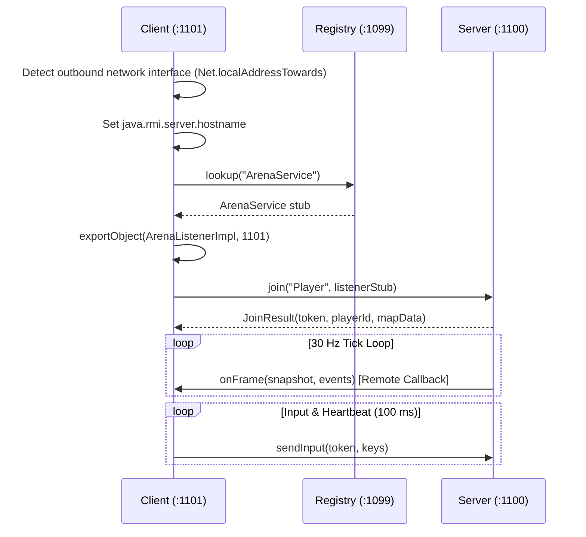

# RMI Arena — Multiplayer Combat Game over Java RMI

A fast-paced 2D multiplayer laser combat game built on top of **Java Remote Method Invocation (Java RMI)**. The server simulates world physics at 30 Hz and pushes state snapshots to connected clients via **bidirectional RMI callbacks**, complete with automatic push-to-pull fallback and remote filesystem inspection.

The arena level geometry is dynamically constructed from the server's filesystem: subdirectories become reflective mirror walls that bounce lasers, and files become destructible crates with hit points scaling with file size.


---

## 1. Quick Start

### Prerequisites
- **Java 17 or newer** (`java -version`).
- A JDK is required to build; a JRE is sufficient to run the pre-built jar.

### Build
```bash
build.bat            # Windows
# or
./build.sh           # macOS / Linux
```
This produces `rmi-arena.jar` in the project root.

### Run

| Role | Command | Description |
|---|---|---|
| **Server** | `java -jar rmi-arena.jar server` | Starts registry (1099), exports services (1100), and opens the Control Room dashboard. |
| **Client** | `java -jar rmi-arena.jar client <server-ip> <name>` | Connects to server, exports callback listener (1101), and opens the game window. |
| **AI Bot** | `java -jar rmi-arena.jar bot <server-ip> 3` | Spawns autonomous bot players running as standard RMI clients. |
| **Remote `ls` CLI** | `java -jar rmi-arena.jar ls <server-ip> [path]` | Standalone CLI client demonstrating remote directory listing over RMI. |

You can also double-click `rmi-arena.jar` or use the provided launcher scripts:
- **`START-SERVER.bat`**: Launches the server with automatic network IP detection.
- **`START-CLIENT.bat`**: Prompts for server IP and player name, then joins the match.

To play locally on the host machine, run:
```bash
java -jar rmi-arena.jar client localhost Player1
```

---

## 2. Controls & Gameplay

| Key | Action |
|---|---|
| <kbd>W</kbd> / <kbd>S</kbd> or <kbd>↑</kbd> / <kbd>↓</kbd> | Thrust forward / reverse |
| <kbd>A</kbd> / <kbd>D</kbd> or <kbd>←</kbd> / <kbd>→</kbd> | Rotate ship |
| <kbd>Space</kbd> | Fire laser (ricochets off mirror walls add **+65% damage** per bounce) |
| <kbd>Shift</kbd> | Dash thruster |
| <kbd>1</kbd>–<kbd>4</kbd> | Tactical radio messages |
| <kbd>TAB</kbd> | In-game remote filesystem explorer (interact via <kbd>↑</kbd>/<kbd>↓</kbd>, <kbd>Enter</kbd>, <kbd>Backspace</kbd>) |
| <kbd>F3</kbd> | Real-time RMI telemetry overlay (latency, call rates, frame delivery) |
| <kbd>M</kbd> | Toggle audio |

**Pickups**:
- **Hotfix (Green)**: Restores ship hull points.
- **Overclock (Yellow)**: Grants rapid laser fire.

---

## 3. Network Architecture & Ports

RMI Arena uses fixed TCP ports to ensure predictable routing and straightforward firewall configuration:

```
          ┌───────────────────────────────────────────────────┐
          │                   RMI REGISTRY                    │
          │                     Port 1099                     │
          └─────────────────▲───────────────┬─────────────────┘
     rebind("ArenaService") │               │ lookup("ArenaService")
                            │               │
  ┌─────────────────────────┴────┐     ┌────▼────────────────────────┐
  │         SERVER HOST          │     │         CLIENT HOST         │
  │                              │     │                             │
  │  ArenaServiceImpl (:1100)    │◄────┼── sendInput() / ping()      │
  │  FileServiceImpl  (:1100)    │◄────┼── list(path)                │
  │                              │     │                             │
  │  Session (Push Worker)       ├─────┼─▶ onFrame() callback (:1101)│
  │  GameWorld (30 Hz Tick)      │     │   ArenaListenerImpl         │
  └──────────────────────────────┘     └─────────────────────────────┘
```

### Port Specifications
- **`1099` (TCP)**: Java RMI Registry.
- **`1100` (TCP)**: Server remote objects (`ArenaService`, `FileService`).
- **`1101` (TCP)**: Client callback listener (`ArenaListener`).

### Windows Firewall Configuration
If Windows Defender Firewall prompts when starting the server or client, allow Java access on both Private and Public networks. Alternatively, open ports via an administrative PowerShell:
```powershell
netsh advfirewall firewall add rule name="RMI Arena" dir=in action=allow protocol=TCP localport=1099-1101
```

---

## 4. Distributed Systems Concepts in Java RMI

### Remote Interfaces & Contract
Java RMI defines remote APIs via plain Java interfaces that extend `java.rmi.Remote`, where every method declares `throws RemoteException`:
- [`ArenaService`](src/arena/common/ArenaService.java): Server interface for player joins, inputs, polling fallback, and pings.
- [`ArenaListener`](src/arena/common/ArenaListener.java): Client callback interface for receiving 30 Hz world snapshots.
- [`FileService`](src/arena/common/FileService.java): Server interface for sandboxed filesystem introspection.

### Pass-by-Value vs. Pass-by-Reference
- **Pass-by-Value**: State data (`PlayerInput`, `Frame`, `GameSnapshot`, `GameEvent`, `MapData`, `FileEntry`) implements `java.io.Serializable`. When passed over RMI, objects are deep-copied via standard Java serialization.
- **Pass-by-Reference**: Remote objects (`ArenaListener`, `ArenaService`, `FileService`) extend `Remote`. When passed as arguments (such as passing the client's `ArenaListener` stub into `arena.join(...)`), RMI transmits the remote stub reference, allowing the server to invoke methods back on the client machine.

### Join & Callback Sequence



### Reliability & Fault Tolerance
1. **Dedicated Client Push Threads ([`Session.java`](src/arena/server/Session.java))**:
   RMI method calls are synchronous and block the caller. To ensure one high-latency or disconnected client cannot stall the server simulation, each connected client has an independent worker thread.
2. **Snapshot Conflation**:
   If a client takes longer than 33 ms to receive a frame, stale snapshots are dropped so the client immediately receives the freshest game state upon catching up.
3. **Push-to-Pull Failover**:
   If a client's firewall blocks incoming callback connections on port 1101, or if three consecutive callbacks fail, the server suspends pushing. When the client detects an absence of incoming frames for 2.5 seconds, it automatically switches to pull mode, fetching frames via `arena.poll(token)`.
4. **Heartbeat & Dead Client Pruning**:
   Every `sendInput` call serves as an active heartbeat. If no communication is received from a client for 8 seconds, the server terminates the session, reclaims its player slot, and broadcasts a disconnect event.
5. **Sandboxed File Access**:
   [`FileServiceImpl`](src/arena/server/FileServiceImpl.java) normalizes requested paths and strictly validates that traversal does not escape the configured shared root directory (rejecting paths such as `../../`).

---

## 5. Project Structure

```
├── howto/                        # Standalone 3-file Java RMI reference implementation
│   ├── DirectoryService.java     # Remote interface contract
│   ├── DirectoryServer.java      # Server exporting service & registry binding
│   └── DirectoryClient.java      # Client lookup & remote invocation
├── src/arena/
│   ├── Main.java                 # Universal entry point & interactive launcher
│   ├── bot/
│   │   └── Bot.java              # Autonomous AI combat agent
│   ├── client/
│   │   ├── ArenaClient.java      # Client entry point, networking & game loop
│   │   ├── ArenaPanel.java       # Swing 2D graphics rendering engine & HUD
│   │   ├── FileBrowser.java      # In-game remote filesystem viewer
│   │   ├── LsClient.java         # CLI client for remote directory inspection
│   │   └── Sfx.java              # Synthesized audio effects generator
│   ├── common/
│   │   ├── ArenaListener.java    # Remote callback interface (client-side stub)
│   │   ├── ArenaService.java     # Server remote interface
│   │   ├── FileService.java      # Remote filesystem interface
│   │   ├── GameRules.java        # Port constants, tick rates, and physics bounds
│   │   ├── Net.java              # Network adapter discovery & RMI socket setup
│   │   └── *.java                # Serializable records (Frame, Snapshot, Input, Events)
│   └── server/
│       ├── ArenaServer.java      # Server bootstrap & registry lifecycle
│       ├── ArenaServiceImpl.java # Implementation of ArenaService
│       ├── FileServiceImpl.java  # Sandboxed remote filesystem implementation
│       ├── GameWorld.java        # Server-authoritative physics & laser raytracer
│       ├── MapBuilder.java       # Dynamic map generator from server directory
│       ├── ServerDashboard.java  # Swing Control Room spectator & telemetry UI
│       ├── Session.java          # Per-client push queue & conflation manager
│       └── Telemetry.java        # Atomic metrics tracking & throughput logger
├── shared/                       # Folder serving as the source for dynamic map layout
├── Dockerfile                    # Container definition with Xvfb and noVNC web UI
├── docker-compose.yml            # Docker Compose configuration
├── build.bat / build.sh          # Build scripts for Windows / Unix
└── START-SERVER.bat / START-CLIENT.bat # Single-click Windows launchers
```

---

## 6. Docker Support

To run an RMI client inside a container with web-based display output (accessible via browser through noVNC):

```bash
docker compose up --build
```
Navigate to `http://localhost:6080/vnc.html` in your web browser to view and control the game client.
